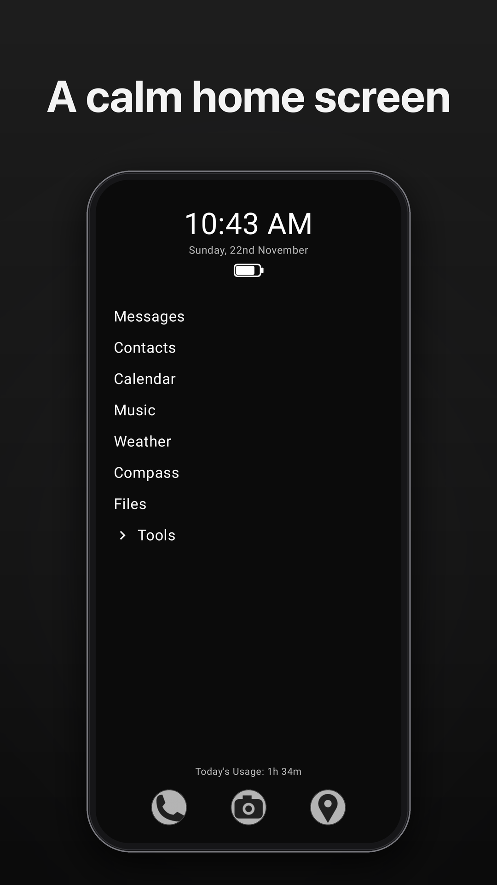
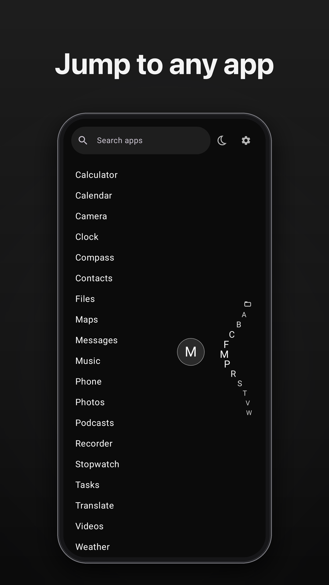
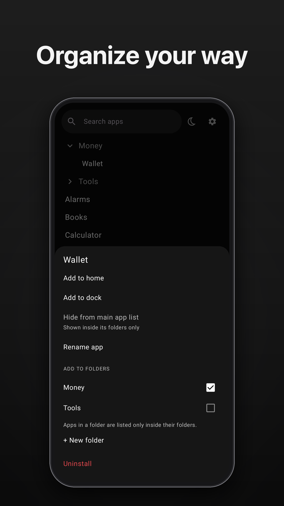
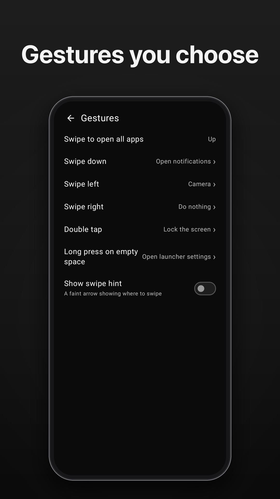

<div align="center">


# Minimalist Launcher

A text-only Android home screen: a clock, a short list of favorite apps, and everything else one swipe away.

[Features](#features) · [Install](#install) · [Gestures](#gestures) · [Build](#build) · [ADB control](#control-it-over-adb)

</div>

Minimalist Launcher replaces the stock home screen with plain text on a near-black background. The only icons are in a small dock. It uses Kotlin and Jetpack Compose.

> [!NOTE]
> The app is called **Minimal** on the device. It needs Android 8.0 (API 26) or newer.

<p align="center">
  
  
  
  
</p>

## Features

- **Home screen:** clock, date, battery, favorite apps as a text list, pinned folders, today's screen time, and a dock of up to five apps.
- **App list:** a search bar, all apps in alphabetical order, folders at the top, and an A to Z side strip with a folder shortcut.
- **Folders:** an app can be in several folders. One folder is open at a time. An app in a folder leaves the main list unless you change this in Settings.
- **Reorder:** long-press a home row and drag it.
- **Rename and hide:** give an app your own name. Search also matches the original name.
- **Gestures:** assign an action to each swipe, to double tap, and to long press.
- **Settings:** text size, and a 12-hour or 24-hour clock.

Long-press an app to add it to or remove it from the home screen, the dock, or a folder. The same menu renames, hides, and uninstalls the app. Long-press a folder to pin it to the home screen, add apps, or delete it.

## Install

1. [Build the APK](#build).
2. Copy it to the phone and open it.
3. Allow installs from the app that opened it.
4. Press Home and choose **Minimal** as the home app. A prompt also appears on first launch.

### Permissions

| Permission | Used for |
| --- | --- |
| Usage access | The "Today's Usage" line on the home screen |
| Do Not Disturb access | The moon button in the app list |
| Accessibility service ("Minimal gestures") | Locking the screen with a gesture, and a backup for opening notifications. It does not read the screen. |

Turn each permission on in Settings → Permissions.

## Gestures

Settings → Gestures sets the action for each gesture on the home screen. One swipe direction always opens the app list. You choose which one. The other directions are free.

| Gesture | Default |
| --- | --- |
| Swipe down | Open notifications |
| Long press on empty space | Open launcher settings |
| Double tap, and the two free swipe directions | Do nothing |

Available actions: open notifications, open quick settings, search apps, lock the screen, toggle the flashlight, toggle Do Not Disturb, open launcher settings, or open an app you choose.

## Build

Requirements: JDK 17 and the Android SDK with platform 35.

```sh
git clone https://github.com/D4NZ-jpg/minimalist-launcher.git
cd minimalist-launcher
echo "sdk.dir=$ANDROID_HOME" > local.properties

./gradlew assembleDebug      # app/build/outputs/apk/debug/
./gradlew assembleRelease    # app/build/outputs/apk/release/
```

> [!NOTE]
> The release build uses R8 and the debug signing key, so it installs over a debug build. Use it for personal installs only.

### Tests

```sh
./gradlew testDebugUnitTest      # unit and UI tests on the JVM
./gradlew recordRoborazziDebug   # same tests, and saves screenshots to app/build/screenshots/
```

## Control it over ADB

A hidden receiver reads and changes the layout from the `adb` shell. It has no screen. It requires the `DUMP` permission, which only the `adb` shell holds, so other apps cannot call it.

Read the layout (apps, favorites, dock, hidden apps, folders, pinned folders, and custom names):

```sh
adb shell am broadcast -n dev.minimalist.launcher/.AgentReceiver \
  -a dev.minimalist.launcher.AGENT --es cmd list
```

Change parts of it. Sections that are not in the plan stay the same. Unknown app keys are dropped and reported:

```sh
adb shell am broadcast -n dev.minimalist.launcher/.AgentReceiver \
  -a dev.minimalist.launcher.AGENT --es cmd apply \
  --es plan "$(base64 < plan.json | tr -d '\n')"
```

```json
{
  "favourites": ["com.example.chat/com.example.chat.Main"],
  "dock": ["com.example.dialer/com.example.dialer.Main"],
  "folders": { "Work": ["com.example.mail/com.example.mail.Main"] },
  "homeFolders": ["Work"],
  "hidden": [],
  "aliases": { "com.example.chat/com.example.chat.Main": "Messages" }
}
```

An app key is `package/activity`, as `list` returns it. The reply is in the `data="..."` part of the broadcast result. The launcher refreshes by itself.
